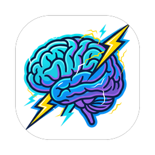
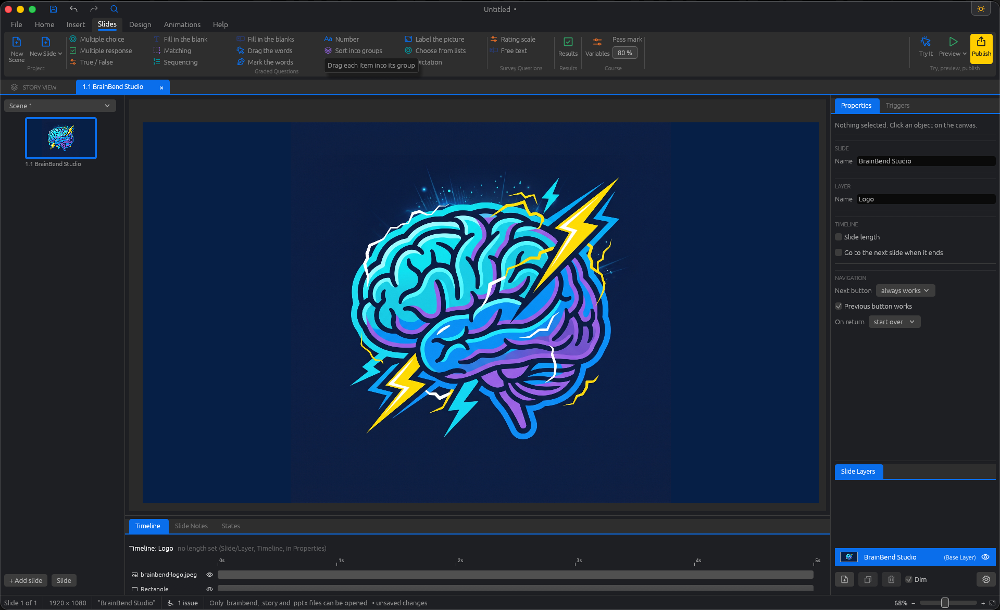

  <picture>
    <source media="(prefers-color-scheme: dark)" srcset="assets/brainbend-icon-dark-256.png">
    
  </picture>

<h1 align="center">BrainBend Studio</h1>

  <b>A free, open-source authoring tool for interactive e-learning.</b> 
  Build slide-based Media Lessons, open PowerPoint and Storyline files, and publish to the web, an LMS, PDF, Word or PowerPoint.

  
  
  
  

  <a href="https://brainbend.org"><b>BrainBend.org</b></a> ·
  <a href="https://brainbend.org/discord/"><b>BrainBend Community on Discord</b></a>

  

> [!NOTE]
> BrainBend Studio is a work in progress, heading for its first release (v0.1.0). Web Lessons are not available to create yet.

## Runs where you do

A native desktop app, not a browser tab. It works offline and keeps your files on your computer.

| Platform | Download |
|---|---|
| **macOS** | One universal `.dmg` that runs natively on Apple silicon and Intel Macs |
| **Windows** | A portable `.exe` in a `.zip` |
| **Linux** | A `.tar.gz` with the binary |

Every change is built and tested on macOS, Windows and Linux. Releases are on the [Releases page](https://github.com/brainbend/studio/releases) and the app can check for updates itself.

## What you can add

**Objects** (Objects tab)

| Group | Objects |
|---|---|
| Text | Text Box · Table · Slide Number |
| Media | Picture · Shape · Video · Audio · Caption (speech and thought bubbles) · 360° Image · Equation · Icons (a vector gallery you can recolor) · Web Object |
| Interactive | Button (with Normal, Hover, Down, Visited, Disabled and Selected states) · Slider · Hotspot (rectangle, oval or freeform) · Dial · Input (check box, radio button, text entry, number entry) · Marker |

**Slides** (Slides tab)

| Kind | Slides |
|---|---|
| Content | A blank slide, or one from a slide layout |
| Graded questions | Multiple choice · Multiple response · True / False · Fill in the blank · Matching · Sequencing · Fill in the blanks · Drag the words · Mark the words · Number · Sort into groups · Find the hotspot · Label the picture · Choose from lists · Dictation |
| Survey questions (not scored) | Rating scale · Free text |
| Results | A quiz results slide that reports the score |

## Fonts

- **Bundled:** 20 open-licensed families, including Inter, Roboto, Lato, Poppins, Montserrat, Open Sans, Playfair Display, Lora and JetBrains Mono, each shown in its own face in the font menu.
- **From Google Fonts:** add any of the 1,900+ families from inside the app. They are saved on your computer and show up in every font menu.
- **Installed on your computer:** every font you have is available while you edit.
- **Published lessons carry their fonts.** Bundled and Google fonts are embedded in the web, SCORM and PDF output so a lesson looks the same on every learner's computer. An installed font is embedded only where its own license allows it; the Publish dialog lists which fonts travel and which fall back.

## Publish

Press **Publish** to choose how the project goes out:

- **Web**: an HTML5 folder named for the project, ready for any web server.
- **Other LMS**: a SCORM package (`.zip`) for SCORM 1.2 or SCORM 2004 4th Edition, reporting completion, score and pass/fail.
- **PDF**: a PDF file saved directly (no print dialog): a handout in portrait or landscape, with 1, 2 or 3 slides per page, optional correct answers, space for notes, slide notes and alt text.
- **Print**: the same handout in your browser's print dialog, for a printer or its own "Save as PDF".
- **Word**: an editable .docx handout with a picture of each slide (questions as they look in the lesson), on a portrait page: one slide with its notes and alt text, or two slides to a page.
- **PowerPoint**: a `.pptx` file.

BrainBend Review, BrainBend LMS and Video are marked Coming soon.

## License

BrainBend Studio is dual-licensed under either of [Apache License 2.0](LICENSE-APACHE) or [MIT](LICENSE-MIT), at your option. The bundled fonts are under the SIL Open Font License 1.1 (texts in [FONT-LICENSES.md](FONT-LICENSES.md)), and the license of each font a lesson uses is copied into its export. Other open-source software the app uses is listed in [THIRD-PARTY-LICENSES.md](THIRD-PARTY-LICENSES.md). The BrainBend name and logo are not covered by these licenses.
